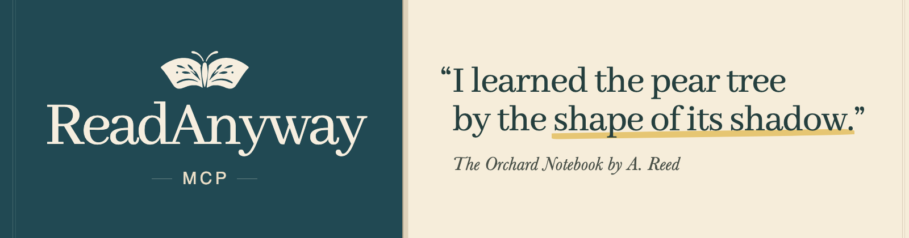

<a name="readanyway-mcp"></a>

# 

Remember a few words from a passage you highlighted? Ask your assistant to find the line and open it in [ReadAnyway](https://readanyway.com/). This read-only Model Context Protocol (MCP) server searches the books and saved highlights you choose to share.

[Connect Codex](#connect-codex-to-readanyway) · [Try the local demo](#try-the-local-demo) · [Example prompts](#what-to-ask) · [Tool reference](#available-tools)

## Connect Codex to ReadAnyway

The hosted pilot works with **Codex CLI 0.170.0** and a [ReadAnyway staging account](https://staging.readanyway.com/). Staging has its own library. To follow along, use a book with at least one synced highlight.

1. **Add the server** to `~/.codex/config.toml`. Update the existing `readanyway-staging` entry if you have one.

   <details>
   <summary>Show the staging configuration</summary>

   ```toml
   [mcp_servers.readanyway-staging]
   url = "https://staging.readanyway.com/api/mcp"
   scopes = ["library:read", "highlights:read"]

   [mcp_servers.readanyway-staging.oauth]
   client_id = "TYCX8NjUXB9jz6sL"
   callback_port = 43817
   callback_url = "http://127.0.0.1:43817/callback"
   ```

   </details>

2. **Sign in.** Run the command below. Clerk opens in your browser and shows the permissions requested by **Codex — ReadAnyway Staging**.

   ```sh
   codex mcp login readanyway-staging --scopes library:read,highlights:read
   ```

3. **Choose your books.** After approving in Clerk, start a new Codex chat with this request.

   ```text
   Use readanyway-staging to list my shared books.
   ```

   The first request returns a sharing link. Open it, select the books you want to share, enable saved highlights, and click **Approve sharing**. You can also share your entire library.

4. **Open a highlight.** Ask Codex to quote a highlight from one of those books and give you its link. Open the link while signed in to staging. **Continue reading here** takes you to the marked passage when its location still matches the current edition.

<details>
<summary>Seeing a “missing issuer” error after signing in?</summary>

Check `codex --version`. Codex CLI 0.144.5 dropped Clerk’s issuer from the callback. The same sign-in passed on 0.170.0. Keep the callback settings under this server’s OAuth table as shown above. [Codex issue](https://github.com/openai/codex/issues/33354)

</details>

## What to ask

| When you want to… | Try asking… |
| --- | --- |
| Find a half-remembered line | “Which of my highlights contain ‘shadow’? Quote each one and link me to the passage.” |
| Compare two books | “Find two shared books where I highlighted the word ‘memory’. Compare how the authors use it and quote the lines you’re comparing.” |
| Quiz yourself | “Pick a highlight from a book I shared. Hide the title and ask me who wrote it. After I guess, show me the book and the link.” |

<a name="what-your-assistant-can-read"></a>

## Available tools

| Tool | Permission | What you can retrieve |
| --- | --- | --- |
| `list_books` | `library:read` | Shared books, including titles, authors, and IDs. Use `query` to match a title or author. |
| `list_highlights` | `highlights:read` | Exact saved excerpts with book titles and citation links. Use `query` to match excerpt text or `book_id` to search one shared book. |

Both tools read synced data. For another page, pass the returned `next_cursor` as `cursor` with the same filters. Each citation still opens the saved excerpt if its location in the book has changed.

**You control sharing.** Open **Connected apps** in ReadAnyway to change the selection or disconnect Codex. Disconnecting stops future reads. Your assistant can retain passages it already received. In the staging pilot, a replacement access token requires fresh sharing approval.

<a name="try-a-local-example"></a>

## Try the local demo

The demo comes with one fictional book, *The Orchard Notebook* by A. Reed. You can try both tools on your computer without a ReadAnyway account. With Node.js 22 or later and the Codex CLI installed, run these commands.

```sh
git clone https://github.com/iarickvigasi/readanyway-mcp.git
cd readanyway-mcp
npm ci
npm run build
codex mcp add readanyway-demo -- node "$PWD/examples/local-library.mjs"
```

Start a new Codex chat and ask **“Use readanyway-demo to find my highlight about a pear tree.”** Codex returns the line from the notebook.

> I learned the pear tree by the shape of its shadow.

The demo returns a placeholder citation on `example.org`. The hosted service opens your saved highlight in ReadAnyway. [Demo source](examples/local-library.mjs)

<a name="use-the-typescript-package"></a>

## Build with the package

`@readanyway/mcp` exports `createReadAnywayServer` and a typed adapter for your books and highlights. It supports ES modules and CommonJS. Before the first npm release, run `npm pack` in the built checkout and install the resulting `.tgz` in your project. [Hosting guide](docs/hosting.md) · [Release guide](docs/releasing.md)

<details>
<summary>Connect Claude Code or a stdio client to your own host</summary>

The staging client is registered for Codex. If your host supports your client’s OAuth flow, replace the example URL with your own MCP endpoint. For Claude Code, run this command and open `/mcp` to authenticate. [Claude Code MCP guide](https://code.claude.com/docs/en/mcp)

```sh
claude mcp add --transport http readanyway https://reader.example.org/api/mcp
```

For a client that launches local stdio servers, add this HTTP bridge to its MCP configuration.

```json
{
  "mcpServers": {
    "readanyway": {
      "command": "npx",
      "args": ["-y", "mcp-remote@0.16.6", "https://reader.example.org/api/mcp"]
    }
  }
}
```

</details>

[MIT license](LICENSE) · [Report an issue](https://github.com/iarickvigasi/readanyway-mcp/issues) · [Build status](https://github.com/iarickvigasi/readanyway-mcp/actions/workflows/test.yml)
