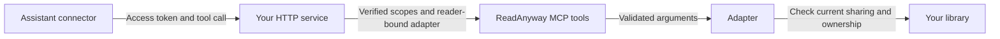

# Host the ReadAnyway tools

The public package exposes a server factory and a two-method data adapter. You can run the same tools over your own dataset. The hosted ReadAnyway product supplies its account service, sharing settings, and database. [Runnable stdio example](../examples/local-library.mjs) · [TypeScript contract](../src/contract.ts)



## Bind the adapter to the reader

Build a new MCP server for the authenticated request. Supply the scopes already verified by your HTTP service. Capture the reader and client identity in the adapter so tool arguments only specify search filters and pagination.

```ts
import {
  createReadAnywayServer,
  type ReadAnywayAdapter,
} from "@readanyway/mcp";

function serverForReader(scopes: string[], adapter: ReadAnywayAdapter) {
  return createReadAnywayServer({ scopes, adapter });
}
```

Implement `listBooks` and `listHighlights`. Both return a page of up to 50 rows and a nullable `next_cursor`. Apply the reader's current book selection and ownership checks before searching or paging. Use the exported `BookPage` and `HighlightPage` types for exact field names. [Public tool contract](../src/contract.ts)

Highlight URLs should open an account-protected preview on your own site. Mark a location `available` only when the reader can jump to the saved passage in the current edition. Text from a different edition can still be returned with `location_status: "unavailable"`.

## Serve remote clients

The hosted ReadAnyway service uses Streamable HTTP at `/api/mcp`. Its HTTP layer advertises protected-resource metadata, accepts tokens for that exact resource, and verifies the requested scope. Clerk handles browser sign-in and OAuth consent. The separate first-party sharing page lets the signed-in reader choose books.

When embedding the package, your host owns discovery, token verification, reader consent, and revocation. You can run the local stdio example with its fixed fictional dataset to develop the adapter before adding remote authorization. [MCP authorization specification](https://modelcontextprotocol.io/specification/latest/basic/authorization) · [MCP transports](https://modelcontextprotocol.io/specification/latest/basic/transports)

## Connect a pre-registered Codex client

If you administer a server with a pre-registered public OAuth client, give readers its client ID, MCP URL and loopback callback base. Enable PKCE, consent and the two reader scopes.

Set the callback base in the top-level keys of your Codex `config.toml` before connecting. These settings apply across Codex MCP logins.

```toml
mcp_oauth_callback_port = 38451
mcp_oauth_callback_url = "http://127.0.0.1:38451/callback"
```

Inspect the `redirect_uri` in the Codex authorization request and register that complete URI with your OAuth provider. Codex can append a stable ID derived from the MCP endpoint to the callback base. In callback-specific mode, `https://reader.example.org/api/mcp` produces `http://127.0.0.1:38451/callback/ONigv8-wL3vU` for the base above. In the tested staging setup, Codex 0.170.0 used `http://127.0.0.1:43817/callback/uLB-Wbi7ZC8Q`. Keep the plain callback base in Codex. [Codex callback implementation](https://github.com/openai/codex/blob/rust-v0.170.0/codex-rs/rmcp-client/src/oauth_callback.rs)

Replace the example values below with your operator's values. Add the remote server, then request the reader scopes if prompted to log in separately.

```sh
MCP_URL='https://reader.example.org/api/mcp'
CLIENT_ID='your-public-client-id'
codex mcp add readanyway --url "$MCP_URL" --oauth-client-id "$CLIENT_ID"
codex mcp login readanyway --scopes library:read,highlights:read
```

Codex discovers the target resource through the server’s metadata. An explicit resource override produced two resource parameters and Clerk rejected the request with `invalid_target` in testing. The hosted example leaves this field unset. [Verified staging configuration](../README.md#connect-codex-to-readanyway)

The public client ID identifies the assistant to the authorization server. The browser returns the one-time authorization code to the listening Codex process at the registered address. [Codex configuration reference](https://developers.openai.com/codex/config-reference)
